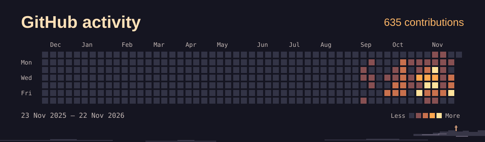

  <picture>
    <source media="(prefers-reduced-motion: reduce)" srcset="assets/coast-banner-still.svg">
    
  </picture> 
  <a href="https://github.com/Martin-Lema?tab=overview#js-contribution-activity">
    <picture>
      <source media="(max-width: 600px)" srcset="assets/coast-activity-mobile.svg">
      
    </picture>
  </a>

