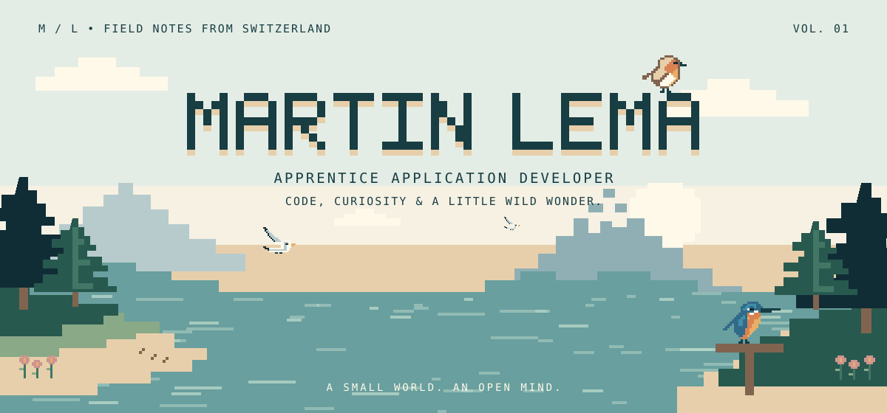
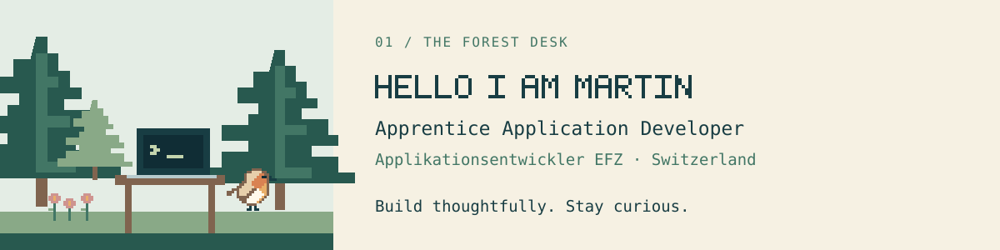
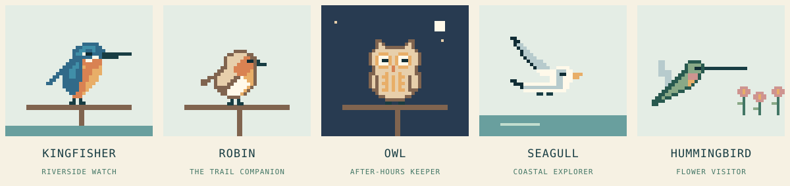
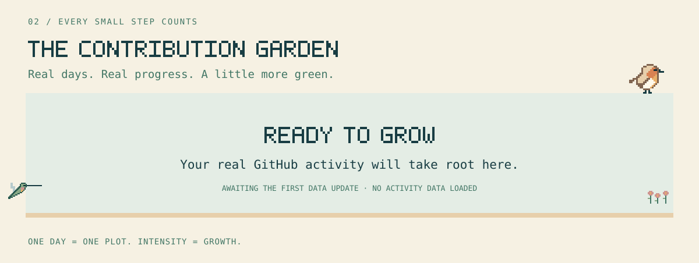
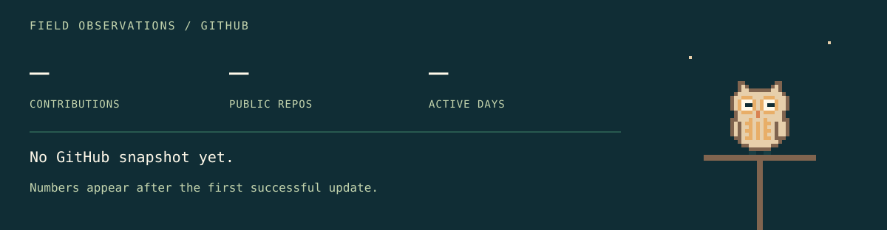
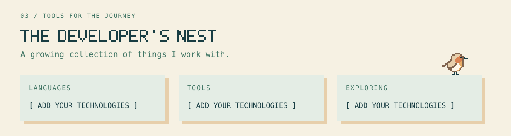
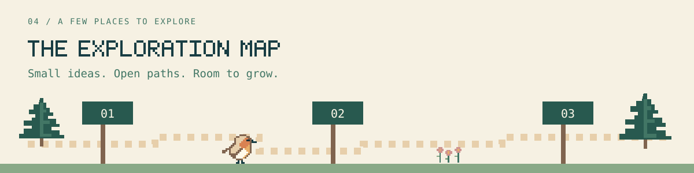
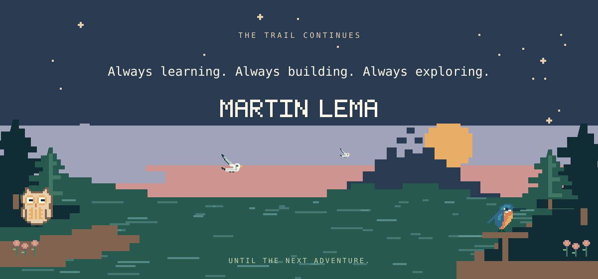

<!-- Generated from profile.json by scripts/build.py. Edit the config, then rebuild. -->

  

S W I T Z E R L A N D &nbsp; / &nbsp; C O D E &nbsp; / &nbsp; C U R I O S I T Y

  

  

Five little residents. One shared world.

### The Contribution Garden

  

  

Awaiting the first GitHub update. [Connect the garden](docs/SETUP.md#real-contributions).

### The Developer's Nest

  

**Languages:** [Add your technologies in profile.json]

**Tools:** [Add your technologies in profile.json]

**Exploring:** [Add your technologies in profile.json]

### The Exploration Map

  

  

Always learning. Always building. Always exploring.

[Animated version](README.md) · [Field guide](docs/SETUP.md)
